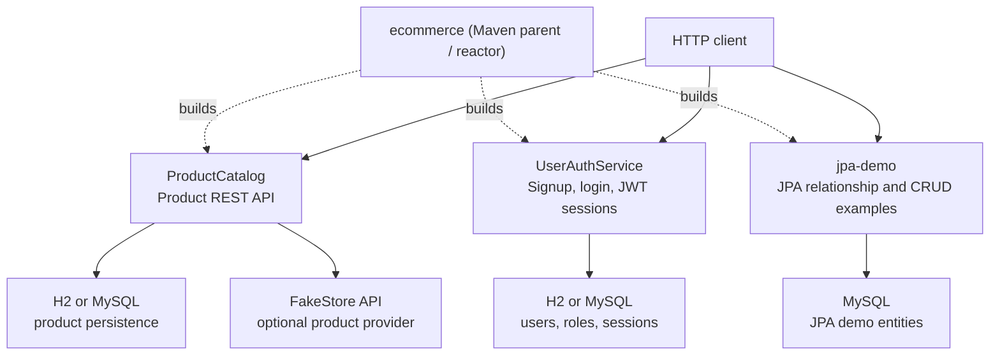

# Ecommerce Backend

This repository is a Maven multi-module workspace for backend learning projects. It contains two standalone Spring Boot services and a separate JPA practice application. The root project is an aggregator and dependency-parent POM; it does not start a server itself.

## Architecture



The three applications are sibling modules: each has its own Spring Boot entry point, HTTP controllers, services, and persistence configuration. They are not wired together through an API gateway or service-to-service calls in this repository. A client can call each application's REST API directly. `ProductCatalog` can use either its JPA repositories or the FakeStore client, selected by configuration. `UserAuthService` handles credentials and JWT-backed sessions independently; the other applications do not currently enforce its tokens.

| Module | Responsibility | Main technologies |
| --- | --- | --- |
| [`ProductCatalog`](ProductCatalog/README.md) | Product CRUD, catalog search, paging, and sorting | Spring Web, Spring Data JPA, MySQL/H2, optional FakeStore integration |
| [`UserAuthService`](UserAuthService/README.md) | User signup/login, password hashing, JWT validation, and logout | Spring Web, Spring Data JPA, BCrypt, JJWT, MySQL/H2 |
| [`jpa-demo`](jpa-demo/README.md) | Instagram-style CRUD and entity relationship examples, plus education-domain entities | Spring Web, Spring Data JPA, MySQL, MapStruct |

`ProductCatalog` and `UserAuthService` both use port `8080` by default, so choose a different `server.port` when running them at the same time. `jpa-demo` uses port `9090`.

## Technology and repository layout

- Java 17 and Spring Boot 3.5.16
- Maven wrapper at the repository root (`mvnw.cmd` on Windows)
- Each module has its own `pom.xml`, application source, configuration, and tests.
- Root `pom.xml` aggregates `ProductCatalog`, `jpa-demo`, and `UserAuthService`.

## Build and test

From the repository root in PowerShell:

```powershell
.\mvnw.cmd clean verify
```

To build or test an individual module:

```powershell
.\mvnw.cmd -pl ProductCatalog verify
.\mvnw.cmd -pl UserAuthService verify
.\mvnw.cmd -pl jpa-demo verify
```

## Run an application

Run one module at a time from the repository root:

```powershell
# H2 and FakeStore-backed product service
.\mvnw.cmd -pl ProductCatalog -Dspring-boot.run.profiles=local spring-boot:run

# H2-backed authentication service
.\mvnw.cmd -pl UserAuthService -Dspring-boot.run.profiles=local spring-boot:run

# JPA demo (configure its MySQL database first)
.\mvnw.cmd -pl jpa-demo spring-boot:run
```

The `dev` profiles for `ProductCatalog` and `UserAuthService` are configured for MySQL; `local` uses an in-memory H2 database. `jpa-demo` currently uses MySQL configuration in `src/main/resources/application.properties`. Set up its database and configure credentials before starting it. See each module README for its APIs and configuration.

## Authentication signing key

Set `JWT_SECRET` for `UserAuthService` to the Base64 encoding of at least 32 cryptographically random bytes. Keep the same value across restarts and application instances, and provide it through the runtime environment or a secrets manager—not in source control or committed application settings. For example, generate a key in PowerShell:

```powershell
[Convert]::ToBase64String([Security.Cryptography.RandomNumberGenerator]::GetBytes(32))
```

Changing the key invalidates tokens signed with the previous key. The local profile uses an in-memory database, so its user/session data is lost when the process stops.
